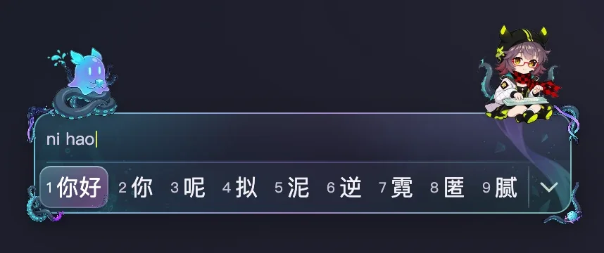
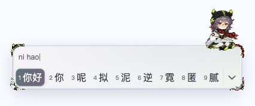
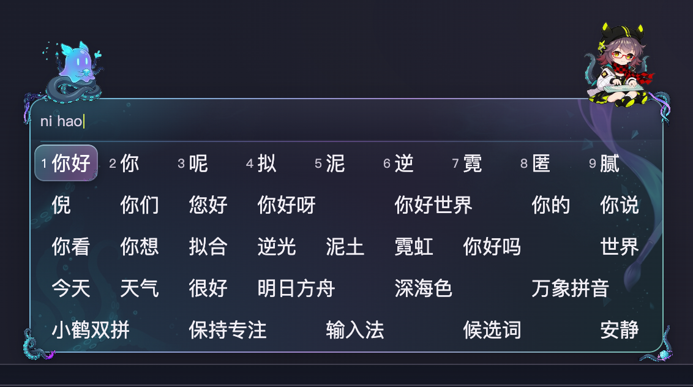
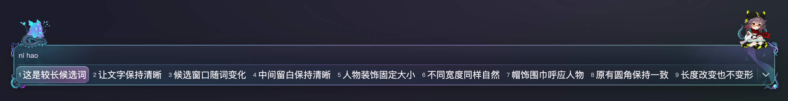

# 深海色（Deepcolor）Fcitx5 macOS 动态输入法主题

当前版本：**v2.3.0**（双角色 MiniMax-H3 视频级 24 帧联动动画 · 触手与精二棱镜四角外饰 · 自适应深海画卷内景）

**Windows 用户**：万象拼音可以通过小狼毫安装，但本仓库的角色动画主题目前不支持 Windows 系统候选窗。请先阅读下方「Windows：万象拼音安装与动态主题兼容性」，不要直接运行 macOS 的 `.command` 脚本。



## 声明

本仓库为纯 AI 生成的个人项目，仅供个人学习与非商业使用。《明日方舟》角色「深海色（Deepcolor）」及相关设定版权归上海鹰角网络科技有限公司（Hypergryph）所有。引用的第三方开源代码不属于 AI 生成内容，仍遵循各自原有许可证（见下文「资源来源与许可说明」）。

---

## 效果展示

### 1. 深色与浅色单行横条

| 深色模式（默认） | 浅色模式 |
| --- | --- |
|  |  |

### 2. 多行展开面板（5 行网格）



### 3. 超长横条自适应测试



---

## 视觉与架构特性

1. **顶部双角色 24 帧视频级联动动画（`.fcitx-panel-top`）**
   - **右上主角色（`.dc-mascot`，`72×72px`）**：Q 版深海色（佩戴黑黄双条纹贝雷帽、红黑格围巾、薄荷绿机械键盘，身后探出深海青蓝吸盘触手）。
   - **左上联动召唤物（`.fcitx-panel-top::before`，`56×56px`）**：精二半透明荧光青蓝-紫罗兰小触手怪召唤物（海蛞蝓幻影，怀抱全息青色棱镜方块、盘坐于深海吸盘触手底座上）。
   - **双态同步切换**：
     - **待机态（`dc-idle`）**：前段保持约 `3.1s` 睁眼静息，后段以 `steps(24, end)` 柔顺完成一次完整的微笑眨眼与触手/围巾轻摆（右上周期 `5.6s`、左上周期 `4.8s` 自然错峰呼吸）。
     - **打字态（`dc-typing`）**：按键输入时立即同步进入 `2.2s` / `2.0s` 24 帧连续循环（深海色双手交替敲击薄荷键盘、背后触手律动；左上小触手怪挥动小画笔与触须洒出荧光青紫颜料），停键 `900ms` 后自动回到待机态。
2. **角色设定还原四角外沿饰件（`assets/character-corners.png`）**
   - 固定 `40×40px` 尺寸，向面板外侧延伸 `11px`（距 `border-box` 外扩 `9px`，完全容纳在 Fcitx5 原生窗口 `24–32px` 阴影安全边界内），不占用任何拼音与候选字排版空间：
     - **左上角（TL）**：缠绕深靛紫与荧光青吸盘触须，直接从左上动态小触手怪底座下方顺左侧框线自然垂落。
     - **右上角（TR）**：从右上坐姿深海色鞋底探出的画笔笔锋、紫罗兰-青蓝流光飘带与深海吸盘触须。
     - **左下角（BL）**：设定集标志性的深海暗蓝巨型吸盘触手盘绕托底 + 紫罗兰颜料飞溅。
     - **右下角（BR）**：精二立绘前景的**全息青蓝 3D 棱镜画匣（内含分层海蛞蝓投影）+ 像素紫罗兰环带 + 深海吸盘触手尾端**。
3. **固定像素锚定的深海画卷内景（`assets/panel-art-left.png` / `panel-art-right.png`）**
   - 面板内部背景采用**左、右双端固定像素尺寸锚定（单行 `168×180px` / 展开 `206×220px`）+ 中央平滑渐隐**的透明 RGBA 墨韵焦散层，配合左上/右上双角色落座处的固定半径生物发光光池（`radial-gradient`）与 `34px` 预编辑行微凹分层：
   - 左侧内景浮现深海吸盘触手剪影、微光气泡与水下焦散波光；右侧内景自深海色脚下垂落紫罗兰-青蓝画笔飘带与几何棱镜碎片。
   - 无论候选框处于短条（`160px`）、普通（`381.5px`）、超长条（`1341.5px`）还是 5 行展开态（`518×208px`），内部画卷均保持 `1:1` 像素清晰度，**零拉伸变形、零接缝**，且深浅两套外观下正文对比度均 `> 11:1`。
4. **第一候选词高亮胶囊内嵌触手微标（`.fcitx-highlighted > .fcitx-candidate-inner::after`）**
   - 选中胶囊具备顶部键帽高光与内环描边，并在胶囊右下内角内嵌一枚半透明微型吸盘触手卷曲徽记（受胶囊 `overflow: hidden` 裁切，零文字挤压）。

---

## 使用教程

### 1. 环境要求

- macOS 系统，已安装 [Fcitx5 macOS](https://github.com/fcitx-contrib/fcitx5-macos)（含 Webpanel 候选窗前端与 `/Library/Input Methods/Fcitx5.app/Contents/bin/fcitx5-curl` 工具）。

### 2. 一键安装与热更新

克隆本仓库后，在终端执行（或直接在 Finder 中双击运行 `应用人物联动角饰.command`）：

```sh
git clone https://github.com/daofaziran1/fcitx5-deepcolor-theme.git
cd fcitx5-deepcolor-theme
./应用人物联动角饰.command
```

该脚本会自动完成以下三步并立即热生效（无需注销或重启输入法）：
1. 将 `deepcolor.css` 与 `assets/` 全套透明贴图复制到 `~/.local/share/fcitx5/www/css/deepcolor-character-v211/`；
2. 将 `plugin/deepcolor-typing/` 动态插件与人物图集同步到 `~/.local/share/fcitx5/www/plugin/deepcolor-typing/`；
3. 调用 `fcitx5-curl /config/addon/webpanel -X POST` 切换 `Advanced.UserCss` 至本主题。

> **首次安装提示**：若本机尚未启用 `deepcolor-typing` 插件或希望导入配套的深浅色字色与紧凑边距配置，可在 Fcitx5 Webpanel 设置中启用插件 `deepcolor-typing`，或参考 `preview-config.js` / `安装验证.json` 中的 `LightMode`、`DarkMode`、`Size`、`Background`（`Blur: None`）参数。

### 3. 本地交互预览工作台

无需改动系统输入法配置，即可在浏览器中完整体验打字联动、单行/展开切换、短条/普通/长条/超长条及深浅色模式：

```sh
cd fcitx5-deepcolor-theme
python3 -m http.server 8794 --bind 127.0.0.1
```

浏览器打开 `http://127.0.0.1:8794/交互预览.html`：
- 在输入框内打字即可观察左上小触手怪与右上深海色的 **24 帧打字联动动画**，停键 `0.9s` 后自动切回**待机呼吸眨眼动画**；
- 点击工具栏分段按钮可测试 `单行` / `展开候选`、`短条` / `普通` / `长条` / `超长条`、`深色` / `浅色` 及 `隐藏/显示示例拼音行`。

### 4. 回退上一版主题

双击运行 `恢复上一版主题.command`（或终端执行 `./恢复上一版主题.command`）即可恢复切换前的配置。

### 5. Windows：万象拼音安装与动态主题兼容性

#### 兼容范围

**万象拼音是 Rime 输入方案，不是候选窗前端；安装万象不会让小狼毫获得 Fcitx5 Webpanel 的主题能力。**

| 使用环境 | 万象中文输入 | 本仓库双角色动画、图片角饰与打字联动 |
| --- | --- | --- |
| macOS：Fcitx5 macOS + Webpanel | 可安装万象方案 | 本仓库原生支持，按上文部署 |
| Windows：小狼毫（Weasel） | 支持，按下文安装 | 不支持；不能导入 `deepcolor.css` 或 `deepcolor-typing` 插件 |
| Windows：浏览器打开 `交互预览.html` | 预览页不是系统输入法 | 可以预览动画，但不会替换其他应用中的系统候选窗 |

原因与上游依据：

- [小狼毫定制文档](https://github.com/rime/weasel/wiki/Weasel-定制化)提供 YAML 配色、字体和布局配置，不提供本主题依赖的 Webpanel CSS／JavaScript 插件接口。
- [fcitx5-webview 平台实现](https://github.com/fcitx-contrib/fcitx5-webview/blob/master/src/platform.cpp)仅包含 macOS、Linux 和 Emscripten 分支，其他平台会触发 `#error "Unsupported platform"`；底层 WebView 支持 Windows，不等于这一候选窗集成已经支持 Windows。
- [Fcitx5 JS](https://github.com/fcitx-contrib/fcitx5-js)的网页／浏览器扩展方案也不能据此视为 Windows 全局 TSF 输入法前端。

因此，本仓库**不提供声称能在官方小狼毫中启用原版角色动画的一键安装命令**。仅转换颜色会丢失角色动画、图片角饰与打字联动，不是原主题的完整移植。若必须保留这些效果，目前不能按小狼毫配色教程完成安装；需要另有可接入 Windows 系统输入、并实现兼容候选窗及插件 API 的前端。

#### 安装 Windows 万象拼音

以下步骤只安装中文输入能力，不会安装上述动态主题。参考[万象官方小狼毫部署指南](https://amzxyz.github.io/rime-wanxiang/doc/weasel.html)。

1. 从[小狼毫官方 Releases](https://github.com/rime/weasel/releases)下载安装包。安装选项选择「中文（简体，中国大陆）」；已有可用小狼毫时无需重复安装。若 `Win + 空格` 的列表中没有「小狼毫」，在 Windows「设置 → 时间和语言 → 语言和区域 → 中文（简体，中国大陆）→ 语言选项 → 添加键盘」中检查并添加。
2. 右键小狼毫托盘图标，打开「用户文件夹」。默认路径是 `%APPDATA%\Rime`；若安装时自定义了路径，以实际用户目录为准。
3. **升级前备份整个用户目录，并先退出算法框架。** 不要删除个人词库、`*.userdb`、自定义短语或已有 `*.custom.yaml`。默认路径可在 PowerShell 中备份：

   ```powershell
   $rime = Join-Path $env:APPDATA 'Rime'
   $backup = "$rime-backup-$(Get-Date -Format yyyyMMdd-HHmmss)"
   robocopy $rime $backup /E /R:0 /W:0 /XF nul
   if ($LASTEXITCODE -ge 8) { throw '备份失败，请先处理错误再继续' }
   ```

   `/XF nul` 仅跳过旧缓存中可能存在的 Windows 保留设备文件名；Robocopy 退出码 `0–7` 不表示复制失败。自定义用户目录时，应先将 `$rime` 改为该目录。
4. 从[万象官方 Releases](https://github.com/amzxyz/rime-wanxiang/releases)下载方案包。首次安装通常选择 **Base（`rime-wanxiang-base.zip`）**；已有 Pro／双拼／辅助码用户应保留原输入习惯，按官方版本说明选择对应方案，不要直接用 Base 覆盖 Pro 配置。
5. 解压后将方案文件放在用户目录根部，而不是再套一层 ZIP 目录。Base 的 `wanxiang.schema.yaml`、`dicts`、`lua` 等应直接位于该目录。对照已有 `default.yaml`、`default.custom.yaml`、`weasel.yaml`、`weasel.custom.yaml` 合并设置；不要不加检查地覆盖全局快捷键、方案列表或外观配置。其他仍在使用的方案也应保留。
6. 按[万象官方部署指南中的「下载语法模型」链接](https://amzxyz.github.io/rime-wanxiang/doc/weasel.html#_3)下载 `wanxiang-lts-zh-hans.gram`，放到同一用户目录根部。模型下载位置以官方指南为准，不要假定 GitHub 存在名为 `model` 的 Release。更新模型前先退出算法框架，避免文件占用。
7. 启动小狼毫并在托盘菜单选择「重新部署」，等待编译完成。若旧编译缓存导致异常，先退出算法框架，将用户目录的 `build` 改名保留，再重新部署；不要为清缓存删除用户词库。
8. 按 `Win + 空格` 切到小狼毫，用 `Ctrl + 反引号` 或 `F4` 打开方案菜单选择万象。在记事本中按所选全拼／双拼编码输入，确认出现候选词并能按空格上屏。只有完成实际中文上屏，才算安装验证通过。

#### 在 Windows 查看原版动画

仅用于查看效果，**不是系统主题安装**。安装 Python 3 后，在仓库根目录运行：

```powershell
py -3 -m http.server 8794 --bind 127.0.0.1
```

浏览器打开 `http://127.0.0.1:8794/交互预览.html`，在页面输入框中打字；页面使用示例候选演示角色待机／打字动画，不与小狼毫候选词连接。结束时在终端按 `Ctrl + C` 关闭服务。无需复制 CSS 到 Rime 用户目录，也不要把 `.command` 改名为 `.bat` 执行。

#### 回退与数据保留

只安装／部署万象不会修改本仓库的 macOS 配置。需要恢复 Windows 输入方案时，先退出小狼毫算法框架，保留当前用户目录，再从自己的备份恢复配置及词库，重新启动并部署。升级后已经新增的用户词条应先同步／导出，避免整目录回退覆盖新数据。

---

## 文件结构

```text
fcitx5-deepcolor-theme/
├── deepcolor.css                      # 主样式表（外框、四角饰件、双角色24帧动画、深海内景、滚动条与交互态）
├── deepcolor-v210.css                 # 历史参考版本样式（v2.1.0 内侧角饰版）
├── assets/
│   ├── character-corners.png          # 四角外沿透明图集（1254×1254 RGBA：墨水触须/画笔触须/巨型吸盘触手/精二棱镜画匣）
│   ├── tentacle-summon-atlas.png      # 左上精二发光小触手怪 25×2 连续动画透明图集（6400×512 RGBA）
│   ├── deepcolor-atlas.png            # 右上Q版深海色（含背后触手）25×2 连续动画透明图集（6400×512 RGBA）
│   ├── panel-art-left.png             # 面板内侧左锚定深海吸盘触手与焦散气泡透明图层（420×448 RGBA）
│   └── panel-art-right.png            # 面板内侧右锚定画笔紫青飘带与棱镜碎片透明图层（420×448 RGBA）
├── plugin/
│   └── deepcolor-typing/
│       ├── dist/index.js              # 动态人物与视口同步插件（v1.6：视口锚定外框、整数点高度展开动画、输入态监听）
│       └── assets/deepcolor-atlas.png # 插件目录同步副本
├── 交互预览.html                       # 本地交互预览工作台页面
├── preview-config.js                  # 预览页与推荐 Webpanel 配置参数
├── native-preview.js                  # 同版本 Fcitx5 Webpanel 前端运行时（仅用于本地预览）
├── fcitx5-webview-LICENSE             # fcitx5-webview 许可证（LGPL-2.1-or-later）
├── 应用人物联动角饰.command             # 一键部署与热生效脚本
├── 恢复上一版主题.command               # 一键回退脚本
├── 动态预览.webp                       # 24 帧打字联动实录 WebP 动图
├── 人物角饰横条预览.png                 # 深色单行预览图
├── 浅色横条预览.png                    # 浅色单行预览图
├── 展开预览.png                       # 5 行展开态预览图
├── 超长横条预览.png                    # 超长横条预览图
└── 外侧边框预览.png                    # 外侧边框细节预览图
```

---

## 资源来源与制作管线

| 资源类别 | 具体文件 | 来源、模型管线与许可证 |
| --- | --- | --- |
| **角色设定参考** | — | 源自《明日方舟》官方设定集《Official Artworks RESET》第 093 页「深海色」干员设定图与精二立绘（通过 BWIKI / Arknights Terra Wiki 公开资料检索核对：吸盘触手召唤物、精二发光海蛞蝓幻影、全息青蓝立体画匣、黑黄贝雷帽与红黑格围巾）。角色设定版权归上海鹰角网络科技有限公司所有。 |
| **双角色 24 帧连续动画图集** | `assets/tentacle-summon-atlas.png`<br>`assets/deepcolor-atlas.png`<br>`plugin/deepcolor-typing/assets/deepcolor-atlas.png` | 1. **首尾关键帧生成**：使用 Antigravity `gemini-3.1-flash-image` 基于官方设定图生成待机/打字首尾关键帧，经 2D L1 躯干模板匹配消除像素偏移；<br>2. **视频中间帧生成**：在 Google Colab A100-SXM4-40GB 上通过 ComfyUI（commit `426f5eea`）运行开源视频生成模型 **[Comfy-Org/MiniMax-H3](https://huggingface.co/Comfy-Org/MiniMax-H3)**（`minimax_h3_fl2va_pruned_int8_convrot.safetensors` + `qwen3vl_32b_minimax_h3_nvfp4_awq.safetensors` + **[lightx2v/Minimax-h3-Turbo](https://huggingface.co/lightx2v/Minimax-h3-Turbo)** 8-step LoRA，`1344×768@24fps`）合成连续动作视频；<br>3. **透明图集后处理**：经连通域白底剥离、面部/白色菱格外套保护掩码、外沿 2px 炭黑描边反溢色（De-haloing）及 24 帧乒乓循环封装为 `6400×512` RGBA 图集。 |
| **四角外沿饰件 & 面板内景图层** | `assets/character-corners.png`<br>`assets/panel-art-left.png`<br>`assets/panel-art-right.png` | 使用 Antigravity `gemini-3.1-flash-image` 结合精二立绘元素生成，经背景色距离场解混（Color-distance unmixing）提取真实半透明 RGBA 通道，并按 `12px` 圆角 45° 对角线接触方程完成几何校准。 |
| **主题 CSS 与动态插件代码** | `deepcolor.css`<br>`plugin/deepcolor-typing/dist/index.js` | 本项目原创维护代码，采用 `SPDX-License-Identifier: GPL-3.0-or-later` 许可。 |
| **本地预览运行时依赖** | `native-preview.js`<br>`fcitx5-webview-LICENSE` | 来自上游开源项目 [fcitx5-webview](https://github.com/fcitx-contrib/fcitx5-webview)，遵循 `LGPL-2.1-or-later` 许可证。 |
